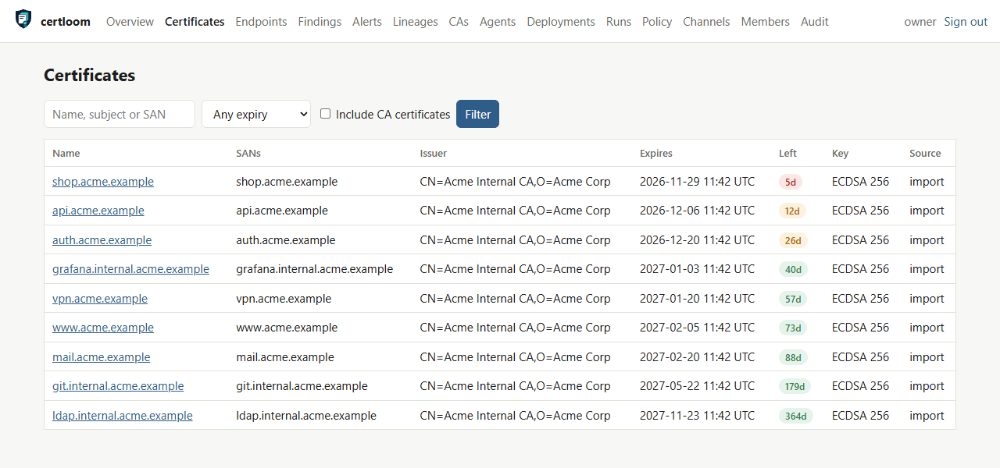

<p align="center">
  <picture>
    <source media="(prefers-color-scheme: dark)" srcset="docs/brand/certloom-mark-dark.svg">
    
  </picture>
</p>

<h1 align="center">certloom</h1>

<p align="center">
  <b>Self-hosted certificate lifecycle management.</b><br>
  Find every TLS certificate, watch what your endpoints really serve, and renew before anything expires.
</p>

<p align="center">
  <a href="../../actions/workflows/ci.yml"></a>
  <a href="LICENSE"></a>
  
  
</p>

<p align="center">
  <a href="deploy/compose/README.md">Install</a> &middot;
  <a href="docs/runbooks/agent.md">Agents</a> &middot;
  <a href="docs/integration-matrix.md">Integrations</a> &middot;
  <a href="docs/adr/README.md">Design</a> &middot;
  <a href="docs/threat-model.md">Threat model</a> &middot;
  <a href="SECURITY.md">Security</a>
</p>

<p align="center">
  <picture>
    <source media="(prefers-color-scheme: dark)" srcset="docs/screenshots/certificates-dark.png">
    
  </picture>
</p>

certloom keeps an inventory of your TLS certificates, probes what your endpoints actually
serve, alerts before anything expires, and renews and deploys certificates through agents
on your hosts. A renewal counts as done only once the endpoint is seen serving the new
certificate.

Pre-1.0 and under active development. There are no tagged releases yet; build from `main`
or run the [Compose install](deploy/compose/README.md).

## Highlights

- **Private keys stay on the host.** Agents generate keys and CSRs locally; the control
  plane never sees a leaf private key and can only name targets the host allows.
- **Verified renewals.** Issue over ACME (HTTP-01, DNS-01, EAB, ARI), Vault PKI or
  step-ca, deploy atomically to nginx or IIS, check the served certificate and roll back
  on failure.
- **Know what is out there.** Import PEM, DER and PKCS#12, probe endpoints within
  allowed scopes, and observe Certbot, win-acme, cert-manager and cloud certificate
  services read-only.
- **Governance built in.** RBAC on PostgreSQL row-level security, approvals with
  separation of duties, versioned policy with plan/apply, and a hash-chained audit log
  you can export and verify.
- **Runs where you do.** Single host with Compose, several replicas behind a load
  balancer, or air-gapped from an offline bundle. Automate it with the REST API, CLI,
  Terraform/OpenTofu or Ansible.

## How it fits together

```
                 browser / certloom CLI / Terraform / Ansible
                                   |  REST API (OIDC or API token)
                                   v
   PostgreSQL <-------------- certloomd --------------> endpoints (TLS probes),
   (RLS, audit chain)         control plane:             email / webhooks
                              API, web UI, scheduler,
                              prober, alerts, approvals
                                   ^
                                   |  mTLS + Ed25519-signed tasks (agents poll)
                                   v
   certloom-agent on each host: keys are generated and stay here, ACME issuance,
   deploy to nginx / IIS / a plugin target, verify, roll back; read-only observation
   of Certbot, win-acme, Kubernetes (cert-manager) and cloud certificate services
```

- **certloomd** holds the inventory, policy, approvals and the workflow engine. It never
  sees a leaf private key. It sends signed tasks; agents decide locally what they allow
  (targets, SANs, task types).
- **certloom-agent** runs on Linux, Windows or in a Kubernetes cluster. It issues over
  ACME (HTTP-01 or DNS-01), deploys atomically, checks what is served and rolls back on
  failure.
- **Plugins** extend the agent with more DNS providers, deploy targets and discovery
  sources. They are signed packages installed on the host with `certloom-plugin`
  ([docs/plugins.md](docs/plugins.md)).

## Repositories

| Repository | What it is | Where to get it |
|---|---|---|
| [certloom](https://github.com/alexandrosnt/certloom) (this one) | Control plane, CLI, agent, plugin installer, Go plugin SDK, Go API client, ADRs and docs | Build from source; agent deb/rpm via `deploy/packaging/build.sh` |
| [terraform-provider-certloom](https://github.com/alexandrosnt/terraform-provider-certloom) | Terraform/OpenTofu provider for certloom configuration (teams, scopes, endpoints, channels, issuers, DNS solvers, templates, policy) | GitHub releases (v0.1.0, GPG-signed). Listing in the OpenTofu registry is pending review; not in the Terraform Registry yet |
| [ansible-collection-certloom](https://github.com/alexandrosnt/ansible-collection-certloom) | Ansible modules for the same configuration, plus a role that installs and enrolls `certloom-agent` | [Ansible Galaxy](https://galaxy.ansible.com/ui/repo/published/alexandrosnt/certloom/): `ansible-galaxy collection install alexandrosnt.certloom` |

Go modules in this repository that others can import:

- `github.com/alexandrosnt/certloom/client`: REST API client, standard library only
  (tagged `client/vX.Y.Z`; used by the Terraform provider).
- `github.com/alexandrosnt/certloom/plugin`: SDK for agent plugins
  (`dnsplugin` is the older DNS-only wrapper).

## What works today

| Area | Status |
|---|---|
| Inventory and monitoring | Import PEM/DER/PKCS#12 (keys never stored), scoped TLS prober with SSRF guards, lineages and owners, checks (expiry, chain, hostname, weak keys, wrong certificate served), alerts by webhook and email with escalation |
| Renewal | ACME (lego v5) with HTTP-01 and DNS-01 (RFC 2136, Cloudflare, plugins, central sealed credentials), wildcards, EAB, ARI scheduling, maintenance windows; Vault PKI and step-ca issuers; deploy to nginx and IIS/HTTP.sys; verify and roll back |
| Trust | CA inventory and rollover planning, trust bundles pushed to agent trust stores with drift detection |
| Governance | RBAC with Postgres row-level security, approvals with separation of duties, policy exceptions, versioned policy with plan/apply, templates, hash-chained audit log with external export |
| Observation (read-only) | Certbot, win-acme, IIS bindings (drift), cert-manager / trust-manager, AWS ACM and Private CA, Azure Key Vault, Google Certificate Manager and CAS, Cloudflare |
| Operations | Several `certloomd` replicas with a leader lease, tested restore with agents catching up, air-gapped install from an offline bundle, reproducible release builds with SBOMs, provenance and signatures |
| Integration | REST API (`api/openapi.yaml`), `certloom` CLI, web UI, OIDC sign-in, Standard Webhooks events, Terraform/OpenTofu, Ansible, agent plugins |

What each integration can do, and the test behind each claim:
[docs/integration-matrix.md](docs/integration-matrix.md). Cloud observation is tested
against API fakes only so far, and the release pipeline has not published a tagged
release yet. Open items: [docs/TODO.md](docs/TODO.md).

## Getting started

- Run the control plane: [deploy/compose/README.md](deploy/compose/README.md)
- Agents on Linux (packages, systemd, nginx, DNS-01, plugins): [docs/runbooks/agent.md](docs/runbooks/agent.md)
- Windows and IIS: [docs/runbooks/windows-iis.md](docs/runbooks/windows-iis.md)
- Kubernetes observation: [docs/runbooks/kubernetes.md](docs/runbooks/kubernetes.md)
- Cloud observation: [docs/runbooks/cloud.md](docs/runbooks/cloud.md)
- Trust bundles and CA rollover: [docs/runbooks/trust-bundles.md](docs/runbooks/trust-bundles.md), [docs/runbooks/ca-rollover.md](docs/runbooks/ca-rollover.md)
- Several replicas, backup and restore: [docs/runbooks/ha.md](docs/runbooks/ha.md), [docs/runbooks/dr.md](docs/runbooks/dr.md)
- Air-gapped networks: [docs/runbooks/airgap.md](docs/runbooks/airgap.md)
- Verifying release signatures: [docs/verify-release.md](docs/verify-release.md)
- Writing plugins: [docs/plugins.md](docs/plugins.md), [docs/dns-plugins.md](docs/dns-plugins.md)
- Events for webhook receivers: [docs/events.md](docs/events.md)

## Layout

```
cmd/certloomd          control plane (API, UI, scheduler, workers, agent listener)
cmd/certloom           CLI
cmd/certloom-agent     host agent
cmd/certloom-plugin    plugin packer and installer (its own Go module)
client/                Go API client (its own Go module)
plugin/, dnsplugin/    plugin protocol and Go SDK
internal/              everything else
api/openapi.yaml       REST API description
deploy/                compose install, systemd unit, deb/rpm packaging, Kubernetes manifests
docs/                  ADRs, threat model, domain model, runbooks, integration matrix
test/                  e2e, workflow, ACME, Kubernetes and scale tests
```

## Build and test

```sh
go build ./cmd/...                                        # certloomd, certloom, certloom-agent
(cd cmd/certloom-plugin && go build .)                    # certloom-plugin
go test ./...                                             # unit tests
(cd client && go test ./...) && (cd cmd/certloom-plugin && go test ./...)
CERTLOOM_TEST_DATABASE_URL=postgres://... go test ./...  # + database, workflow and e2e tests (Docker for e2e)
CERTLOOM_ACME_E2E=1 go test ./test/acme/                  # agent, nginx, BIND, systemd against Pebble (Docker)
CERTLOOM_KUBE_E2E=1 go test ./test/kube/                  # kind + cert-manager (Docker)
```

## Design documents

Decisions are recorded as ADRs in [docs/adr/](docs/adr/README.md); the threat model is
[docs/threat-model.md](docs/threat-model.md). Security reports: [SECURITY.md](SECURITY.md).

## License

Apache-2.0. Contributions need a DCO sign-off (`git commit -s`), see
[CONTRIBUTING.md](CONTRIBUTING.md).
